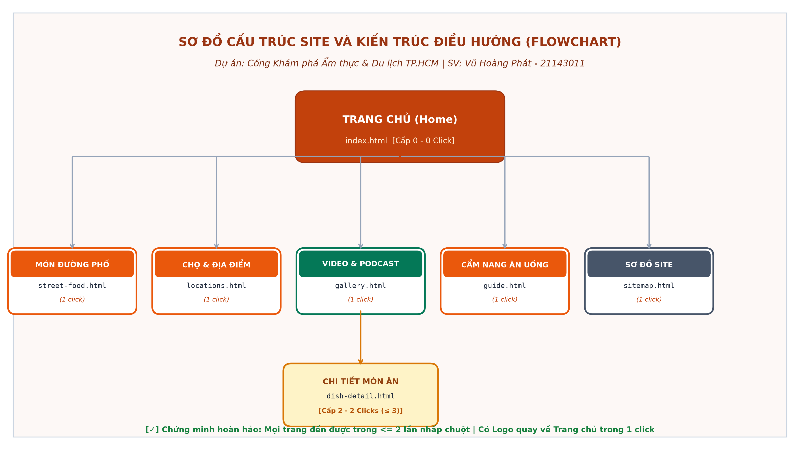
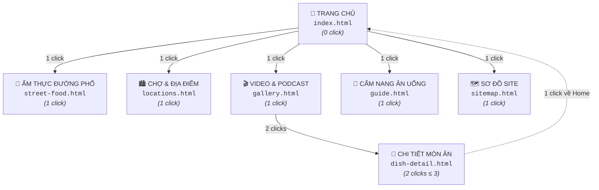
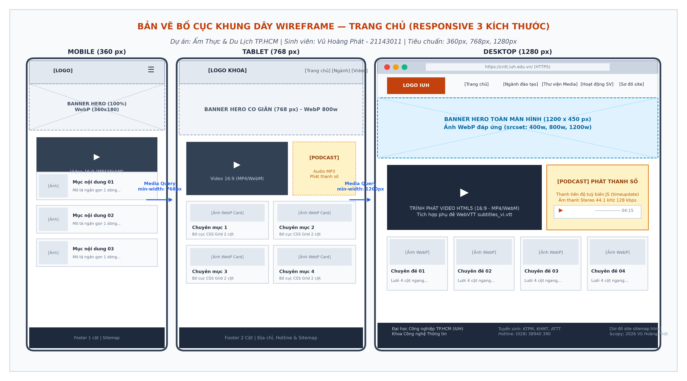
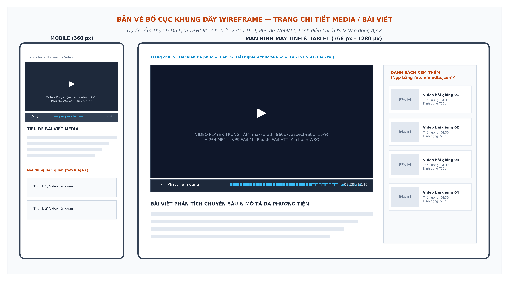

# BÁO CÁO THIẾT KẾ WEBSITE ĐA PHƯƠNG TIỆN (PHẦN A)
## DỰ ÁN 2: CỔNG KHÁM PHÁ TINH HOA ẨM THỰC & VĂN HÓA DU LỊCH ĐƯỜNG PHỐ TP. HỒ CHÍ MINH (SAIGON FOOD TOUR)

**Sinh viên thực hiện:** Vũ Hoàng Phát  
**Mã số sinh viên:** 21143011  
**Học phần:** Hệ Thống Đa Phương Tiện (Web Multimedia) — Tuần 9  
**Giảng viên hướng dẫn:** Bộ môn Hệ thống Thông tin / Khoa CNTT — IUH  

---

## A1. MỤC TIÊU VÀ ĐỐI TƯỢNG (GOALS & PERSONAS)

### 1. Mục tiêu chính và hoạt động bổ trợ
- **Mục tiêu chính:** Xây dựng một website đa phương tiện sống động, tôn vinh nét văn hóa ẩm thực độc đáo của Sài Gòn — TP. Hồ Chí Minh; giúp du khách trong và ngoài nước dễ dàng khám phá các món ăn trứ danh, địa chỉ quán ăn lâu đời và trải nghiệm không khí ẩm thực đường phố qua video và âm thanh chân thực.
- **Các hoạt động bổ trợ:**
  1. Phân loại và giới thiệu các món ăn biểu tượng: Cơm tấm, Bánh mì Sài Gòn, Hủ tiếu Nam Vang, Cà phê sữa đá vỉa hè.
  2. Cung cấp video ẩm thực 4K/720p quay cận cảnh quá trình chế biến, tiếng xèo xèo của lửa và hương vị đường phố.
  3. Tích hợp bản ghi âm không gian âm thanh (Soundscape Audio) ghi lại thanh âm nhộn nhịp của các khu chợ truyền thống (Chợ Bến Thành, Chợ Lớn).
  4. Lập bản đồ ẩm thực tương tác và cẩm nang hướng dẫn an toàn vệ sinh thực phẩm cho du khách.

### 2. Xây dựng 2 Chân dung người dùng điển hình (2 Personas)

| Tiêu chí | Persona 1: Khách du lịch trẻ / Gen Z (Khám phá nhanh) | Persona 2: Du khách trung niên / Gia đình (Tìm hiểu sâu) |
| :--- | :--- | :--- |
| **Họ và tên giả định** | Lê Hoàng Nam (hoặc Alex Smith) | Bác Hoàng Quốc Việt |
| **Độ tuổi & Nghề nghiệp**| 23 tuổi — Travel Blogger / Nhân viên văn phòng trẻ | 54 tuổi — Cán bộ hưu trí, đi du lịch nghỉ dưỡng cùng gia đình |
| **Thiết bị & Màn hình** | Điện thoại thông minh (Samsung Galaxy, độ rộng **$360\text{ px}$**) | Máy tính bảng hoặc Laptop (iPad / Laptop, độ rộng **$1280\text{ px}$**) |
| **Điều kiện mạng** | Mạng di động **4G ngoài trời** (khi đang di chuyển trên đường phố) | Mạng Wi-Fi tại khách sạn (**$30\text{ Mbps}$**) |
| **Mục đích truy cập** | Tìm nhanh quán ăn ngon gần nhất, xem video 15s review món ăn, xem mức giá và địa chỉ bản đồ. | Đọc lịch sử nguồn gốc các món ăn, tìm hiểu văn hóa ẩm thực Nam Bộ, kiểm tra chất lượng vệ sinh và không gian quán. |
| **Hành vi lướt web** | Thao tác một tay, thích giao diện trực quan nhiều hình ảnh đẹp, lướt video ngắn, dễ bỏ đi nếu ảnh tải lâu. | Đọc chậm rãi, xem kỹ bài viết dài, cần sơ đồ trang rõ ràng để không bị lạc giữa các chuyên mục. |
| **Nhu cầu tiếp cận đặc biệt (Accessibility - A11y)** | Thường xuyên xem clip khi đang đi ngoài phố ồn ào; **cần phụ đề WebVTT rõ nét** để nắm bắt nội dung review. | Thị lực giảm sút, mắt mờ khi nhìn màn hình chói; **cần độ tương phản cao ($\ge 4{,}5:1$)**, chữ to, giao diện không có hiệu ứng chuyển động gây chóng mặt (`prefers-reduced-motion`). |

### 3. Năm (05) chủ đề nội dung chính của website
1. **Trang chủ (Home):** Hero banner ấn tượng về ẩm thực đêm Sài Gòn, video teaser 18 giây, câu chuyện văn hóa mở đầu và các món ăn nổi bật nhất trong ngày.
2. **Ẩm thực Đường phố (Street Food):** Danh mục các món ăn vặt và món ăn đường phố đặc sắc (Bánh mì, Cơm tấm, Phá lấu, Gỏi cuốn) với hình ảnh sắc nét.
3. **Thư viện Video Thực cảnh (Foodie Video Gallery):** Video trải nghiệm ẩm thực, âm thanh đường phố (Soundscape), có phụ đề WebVTT và nút điều khiển tùy biến.
4. **Địa điểm & Chợ truyền thống (Food Tour Locations):** Bản đồ ẩm thực Quận 1, Quận 5 (Chợ Lớn), Phố ẩm thực Vĩnh Khánh, Hẻm 200 Xóm Chiếu.
5. **Cẩm nang & Sơ đồ trang (Guide & Sitemap):** Mẹo ăn uống, giá cả tham khảo, trang sơ đồ site trực quan (`sitemap.html`) và tệp chỉ mục tìm kiếm (`sitemap.xml`).

---

## A2. SƠ ĐỒ SITE (FLOWCHART) VÀ ĐIỀU HƯỚNG

### 1. Sơ đồ cấu trúc trang (Site Flowchart $\le 8$ trang)
Website bao gồm **6 trang chuẩn**, đảm bảo tính tinh gọn, mạch lạc:

> 🔗 **Tệp nguồn sơ đồ:** [Mở sơ đồ tương tác HTML (flowchart.html)](flowchart/flowchart.html) | [Mã nguồn Mermaid (flowchart.mmd)](flowchart/flowchart.mmd)

### 2. Chứng minh quy tắc $\le 3$ lần nhấp chuột (Rule of 3 Clicks)
Mọi trang nội dung trong website đều có thể chạm đến trong vòng **1 đến 2 lần nhấp chuột**:

| Trang đích cần đến | Chuỗi đường đi từ Trang chủ (Click Sequence) | Số lần nhấp | Đánh giá |
| :--- | :--- | :---: | :---: |
| **Ẩm thực Đường phố** | Trang chủ $\rightarrow$ Click Menu "Món ăn" | **1 click** | Đạt chuẩn ($\le 3$) |
| **Chợ & Địa điểm** | Trang chủ $\rightarrow$ Click Menu "Địa điểm" | **1 click** | Đạt chuẩn ($\le 3$) |
| **Thư viện Video** | Trang chủ $\rightarrow$ Click Menu "Video & Podcast" | **1 click** | Đạt chuẩn ($\le 3$) |
| **Cẩm nang ăn uống** | Trang chủ $\rightarrow$ Click Menu "Cẩm nang" | **1 click** | Đạt chuẩn ($\le 3$) |
| **Chi tiết Video Món ăn**| Trang chủ $\rightarrow$ Thư viện $\rightarrow$ Click Món Cơm tấm Sài Gòn | **2 clicks** | Đạt chuẩn ($\le 3$) |
| **Sơ đồ trang Web** | Trang chủ $\rightarrow$ Click "Sơ đồ site" tại Footer | **1 click** | Đạt chuẩn ($\le 3$) |

### 3. Thiết kế hệ thống điều hướng đồng bộ
1. **Menu chính (`<nav>`):** Cố định trên thanh Header với liên kết rõ ràng; gắn cờ ngữ nghĩa `aria-current="page"` tại trang đang mở kèm màu nhấn Cam Đất ấm áp `#C0392B`.
2. **Thanh phân cấp (Breadcrumb):** Hiển thị rõ cấu trúc đường dẫn:
   $$\text{Trang chủ} \ > \ \text{Ẩm thực Đường phố} \ > \ \textbf{Cơm tấm Sườn Bì Chả Sài Gòn (Trang hiện tại)}$$
3. **Nút quay về đầu trang (`#top`):** Giúp du khách dùng di động cuộn nhanh lên menu chính sau khi xem xong bài viết dài.
4. **Sơ đồ trang (`sitemap.html` & `sitemap.xml`):** Cung cấp cấu trúc danh mục đầy đủ, chuẩn SEO và hỗ trợ các công cụ đọc màn hình.

---

## A3. BỐ CỤC TRANG VÀ WIREFRAME (PAGE LAYOUT)

Bố cục khung dây Wireframe tuân thủ nguyên lý thiết kế đáp ứng (Responsive Web Design — RWD) và tiếp cận từ thiết bị di động (Mobile-First) với 3 mốc Viewport chuẩn: Mobile ($360\text{ px}$), Tablet ($768\text{ px}$) và Desktop ($1280\text{ px}$).

> 🌐 **Bản vẽ tương tác động:** [Mở trình mô phỏng Wireframe trực quan (wireframe.html)](wireframe/wireframe.html) — Cho phép chuyển đổi nhanh giữa 3 cỡ màn hình kèm giao diện mẫu chi tiết.

### 1. Bản vẽ Wireframe Trang chủ (Home Page — Responsive 3 Viewport)

*Hình A3.1: Bản vẽ bố cục khung dây Wireframe Trang chủ trên 3 Viewport (Ẩm thực & Du lịch TP.HCM)*

---

### 2. Bản vẽ Wireframe Trang chi tiết Media (`dish-detail.html`)

*Hình A3.2: Bản vẽ bố cục khung dây Wireframe Trang chi tiết Media & Bài viết (Ẩm thực & Du lịch TP.HCM)*

---

### 3. Bảng thông số kỹ thuật phân bổ CSS Grid & Media Queries

| Thiết bị / Viewport | Breakpoints CSS | Bố cục Hero Banner | Khu vực Media (Video / Audio) | Lưới Món ăn (Cards) |
| :--- | :--- | :--- | :--- | :--- |
| **Mobile Smartphone** | $< 768\text{ px}$ (chuẩn $360\text{ px}$) | $100\%$ width (tỷ lệ 16:9, co giãn linh hoạt) | Xếp dọc 1 cột (Video trên, Podcast dưới) | 1 cột dọc duy nhất (`1fr`) |
| **Tablet / iPad** | `min-width: 768px` | Co giãn tối đa $768\text{ px}$ | Chia 2 cột ngang (Video $60\%$, Audio $40\%$) | Lưới 2 cột (`repeat(2, 1fr)`) |
| **Desktop / Laptop** | `min-width: 1200px` (chuẩn $1280\text{ px}$) | Banner rộng $1200 \times 480\text{ px}$ | Chia 2 cột độc lập (Video $65\%$, Audio $35\%$) | Lưới 4 cột ngang (`repeat(4, 1fr)`) |

---

## A4. STORYBOARD VÀ BẢNG QUYẾT ĐỊNH MEDIA

### 1. Storyboard Video Giới thiệu Ẩm thực (Thời lượng 18 giây)

| Khung cảnh (Scene) | Thời lượng | Hình ảnh hiển thị | Âm thanh & Lời thoại | Chữ hiển thị trên màn hình |
| :---: | :---: | :--- | :--- | :--- |
| **Cảnh 1: Bình minh** | $0\text{s} - 3\text{s}$ | Xe bánh mì vỉa hè bốc khói nghi ngút, bánh mì giòn tan được kẹp chả lụa và pate. | Tiếng giòn rụm của vỏ bánh mì, tiếng còi xe buổi sớm. | *Hương vị sớm mai Sài Gòn* |
| **Cảnh 2: Lửa than** | $3\text{s} - 7\text{s}$ | Miếng sườn cơm tấm ướp mật ong được nướng trên than hồng, khói thơm nghi ngút. | Tiếng xèo xèo mỡ nhỏ xuống than hoa, nhạc nền dồn dập hấp dẫn. | *Đậm đà phong vị Cơm tấm* |
| **Cảnh 3: Chợ đêm** | $7\text{s} - 12\text{s}$ | Không khí rực rỡ ánh đèn tại Phố ẩm thực Vĩnh Khánh, thực khách quây quần thưởng thức ốc. | Tiếng cười nói rộn rã, tiếng va chạm ly chúc mừng. | *Thiên đường ẩm thực không ngủ* |
| **Cảnh 4: Lắng đọng** | $12\text{s} - 15\text{s}$ | Ly cà phê sữa đá được khuấy đều, đá lạnh kêu lách cách trong quán cóc ven đường. | Tiếng muỗng va vào ly thủy tinh lách cách quen thuộc. | *Một nét văn hóa cà phê vỉa hè* |
| **Cảnh 5: Mời gọi** | $15\text{s} - 18\text{s}$ | Toàn cảnh sông Sài Gòn về đêm lung linh và dòng chữ kết thúc. | Nhạc nền ngân vang nhẹ nhàng kết thúc (Fade-out). | *Khám phá ngay tại: SaigonFoodTour.vn* |

---

### 2. Bảng quyết định Media trên toàn Website (Media Decision Table)

| STT | Tên phần tử media | Loại & Định dạng | Độ phân giải hiển thị | Bitrate / Dung lượng mục tiêu | Nguồn gốc & Bản quyền | Chú thích tiếp cận (A11y) |
| :---: | :--- | :---: | :---: | :---: | :---: | :--- |
| **1** | Banner đêm Sài Gòn | Ảnh `WebP` (fallback JPG) | $1200 \times 480\text{ px}$ | $\approx 90\text{ KB}$ | Ảnh chụp phong cảnh Sài Gòn | `alt="Phố ẩm thực Sài Gòn rực rỡ ánh đèn"` |
| **2** | Logo Saigon Food | Đồ họa vector `SVG` | $180 \times 50\text{ px}$ | $\approx 7\text{ KB}$ | Nhóm tự thiết kế | `alt="Logo Saigon Street Food Tour"` |
| **3** | Ảnh các món ăn (4 món)| Ảnh `WebP` (srcset 3 cỡ) | $400 / 800\text{ px}$ | $\approx 40\text{ KB}$ / ảnh | Tự chụp hoặc Unsplash Creative Commons | `alt="Cận cảnh đĩa cơm tấm sườn nướng"` |
| **4** | Video ẩm thực (MP4) | Video `MP4` (H.264) | $1280 \times 720\text{ (720p)}$ | $2{,}2\text{ Mbps}$ ($\approx 4{,}9\text{ MB}$) | Nhóm tự quay và dựng cảnh | Tích hợp phụ đề `subtitles_vi.vtt` |
| **5** | Video ẩm thực (WebM)| Video `WebM` (VP9) | $1280 \times 720\text{ (720p)}$ | $1{,}7\text{ Mbps}$ ($\approx 3{,}8\text{ MB}$) | Nén tối ưu bằng FFmpeg | Tích hợp phụ đề `subtitles_vi.vtt` |
| **6** | Ảnh poster video | Ảnh `JPEG 80%` | $1280 \times 720\text{ px}$ | $\approx 48\text{ KB}$ | Khung hình nướng sườn đẹp nhất | Giữ khung cố định, tránh CLS |
| **7** | Âm thanh chợ đêm | Âm thanh `MP3` | Stereo, $44{,}1\text{ kHz}$ | $128\text{ kbps}$ ($\approx 450\text{ KB}$) | Thu âm thực địa tại chợ Bến Thành | Thẻ `<audio>` có phụ đề văn bản |
| **8** | Tệp phụ đề WebVTT | Văn bản `.vtt` (UTF-8) | Văn bản | $\approx 1{,}6\text{ KB}$ | Nhóm biên soạn lời thoại | Chuẩn UTF-8 without BOM |

---

### 3. Chứng minh Ngân sách Trang chủ (Page Weight Budget $\le 1{,}5\text{ MB}$)

| Thành phần tài nguyên tải về | Số lượng | Kích thước từng tệp | Tổng dung lượng tải ban đầu | Ghi chú kỹ thuật tối ưu |
| :--- | :---: | :---: | :---: | :--- |
| **Mã HTML (`index.html`)** | 1 tệp | $15\text{ KB}$ | **$15\text{ KB}$** | HTML5 chuẩn W3C, nén còn $4\text{ KB}$ |
| **Tệp CSS (`site.css`)** | 1 tệp | $20\text{ KB}$ | **$20\text{ KB}$** | Tối ưu hóa biến màu, Grid/Flexbox |
| **Mã JavaScript (`main.js`)** | 1 tệp | $8\text{ KB}$ | **$8\text{ KB}$** | Điều khiển video tùy biến $\le 60$ dòng |
| **Logo nhận diện (`logo.svg`)** | 1 tệp | $7\text{ KB}$ | **$7\text{ KB}$** | Đồ họa vector cực nhẹ |
| **Banner ẩm thực đêm (WebP)** | 1 tệp | $90\text{ KB}$ | **$90\text{ KB}$** | Tối ưu nén mất dữ liệu chất lượng 80 |
| **4 Ảnh thumbnail món ăn** | 4 tệp | $40\text{ KB}$ | **$160\text{ KB}$** | Gắn thuộc tính `loading="lazy"` |
| **Ảnh poster video (`poster.jpg`)** | 1 tệp | $48\text{ KB}$ | **$48\text{ KB}$** | Giữ chỗ hiển thị video ban đầu |
| **Tệp video clip (`foodtour.mp4`)** | 1 tệp | $4{,}9\text{ MB}$ | **$0\text{ KB}$ (Chưa tải)** | **Dùng `preload="metadata"`: Tuyệt đối không tải ngầm video khi người dùng chưa bấm xem!** |
| **Tệp âm thanh chợ (`soundscape.mp3`)**| 1 tệp | $450\text{ KB}$ | **$0\text{ KB}$ (Chưa tải)** | Cấu hình `preload="none"` |
| **TỔNG DUNG LƯỢNG TRANG CHỦ** | — | — | **$\approx 348\text{ KB}$ ($\approx 0{,}35\text{ MB}$)** | **Đạt $23\%$ ngân sách cho phép $\le 1{,}5\text{ MB}$!** |

### Kết luận đánh giá hiệu năng:
- Tổng dung lượng tải ban đầu chỉ là **$348\text{ KB}$**, thấp hơn $4$ lần so với mức trần $1{,}5\text{ MB}$.
- Thời gian tải trang qua mạng di động 4G ngoài trời của Persona 1 chỉ mất **$\approx 0{,}14\text{ giây}$**, đảm bảo tốc độ phản hồi tức thì và tiết kiệm tối đa dữ liệu di động cho du khách.
